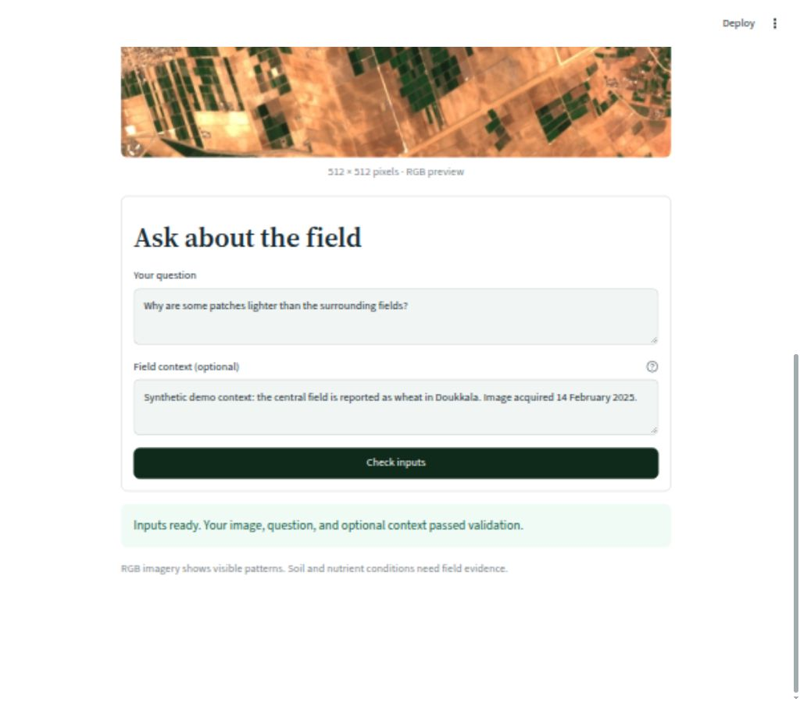

# Step 1 verification

Checked 11 November 2026 on Linux, Python 3.14.4, Streamlit 1.67.0, Pillow 13.0.0.

## Automated checks

- `python -m unittest discover -s tests -v`: **11 tests passed**. Covers real PNG
  decoding, JPEG acceptance, content/size/pixel/frame validation, all three demo
  previews through AppTest, empty/space-only questions, misleading filenames,
  retained form text, and submission feedback not repeating on an unrelated rerun.
- `uv pip check --python .venv/bin/python`: all **34 installed packages** compatible.
- Official `designmd lint DESIGN.md`: **0 errors, 0 warnings** after correcting
  the component token references.
- Premium UI static audit: **0 findings**, saved in `step1_ui_audit.json`. That
  generic auditor targets web source formats, not Python-rendered Streamlit
  behavior; the AppTest and browser checks provide the relevant runtime evidence.
- `.env`, `.venv/`, and generated bytecode remain Git-ignored. The app does not
  import an API client or read credentials.

## Browser checks

- Started the app on `127.0.0.1:8501` and opened it in the in-app browser.
- Empty submission displayed image and question correction messages.
- Uploaded the real Doukkala PNG, saw the 512 × 512 RGB preview, entered a
  question and synthetic context, and received “Inputs ready.”
- Tab from the context field focused “Check inputs”; Enter submitted successfully.
- At 1024 px and 320 px viewport widths, document width equaled viewport width.
  At 320 px both textareas remained inside the viewport (left 33 px, right 277 px).
- Inspected the narrow image/form layout and saved screenshots. Restored the
  normal viewport afterward.
- The first test-server process stopped gracefully during verification, producing
  connection errors in the browser. Restarted in an interactive terminal and
  repeated upload and keyboard submission successfully. No new browser warnings
  or errors were captured after that restart.

[Narrow-screen screenshot](screenshots/step1_narrow.png)

## Limits

Gemini, RAG, streaming, deployment, other operating systems, full screen-reader
testing, and an exhaustive browser/zoom matrix were not exercised. Native
Streamlit controls provide the initial accessibility behavior; this is not WCAG
certification. Refreshing a browser or stopping the local server can lose session
inputs. Direct dependencies are pinned; transitive dependencies are not locked.
