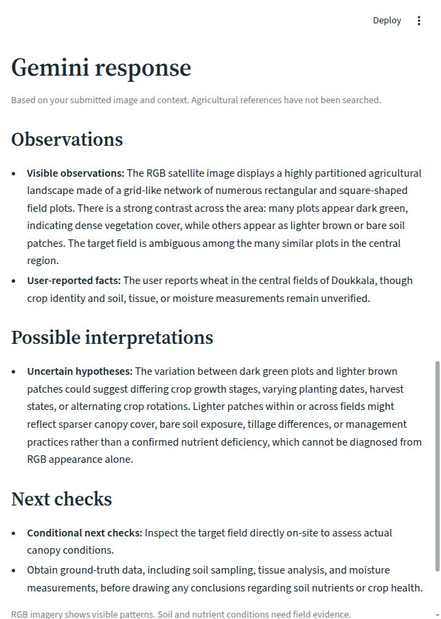

# Step 2 verification

Checked 11 November 2026 on Linux with Python 3.14.4, Streamlit 1.67.0,
Pillow 13.0.0, Google Gen AI SDK 3.1.0, python-dotenv 1.2.4, and httpx2 2.16.0.

## Automated checks

- `python -m unittest discover -s tests -v`: **23 tests passed**.
- The suite covers original image/form checks, metadata removal and orientation,
  valid submissions, changed question/context, answer retention without a repeat
  call, clearing stale answers, and retaining form values after failure.
- Real SDK serialization is checked with a simulated HTTP transport: PNG bytes,
  question/context JSON, system prompt, explicit key header, and endpoint.
- Simulated credential, quota, rejection, model-access, service, timeout, and
  connection failures display safe messages. Blocked, empty, truncated, or
  thought-only output is not rendered as a complete answer. Prepared payloads
  over the byte limit are rejected before an HTTP request.
- SDK retry behavior was exercised: provider errors made one attempt each.
- `uv pip check --python .venv/bin/python`: **52 packages compatible**.
- Official `designmd lint DESIGN.md`: **0 errors, 0 warnings**.
- Strict premium UI static audit: **0 findings**, saved in
  [step2_ui_audit.json](step2_ui_audit.json). This generic web-source scanner does
  not inspect Python-rendered Streamlit behavior; it supplements the AppTest and
  real browser evidence rather than proving runtime correctness.

The ordinary test suite makes no real Gemini calls and uses no real credentials.
AppTest can emit Streamlit's bare-thread ScriptRunContext notice while initializing;
no test was skipped or suppressed.

## Real application call

A fresh browser session uploaded the actual Doukkala Sentinel-2 PNG, entered the
question and clearly labeled synthetic context recorded in
[step2_live_test.json](step2_live_test.json), and selected **Ask Gemini** once.

The application displayed a complete response. It described rectangular/square
field plots and colour variation, noted target-field ambiguity, treated the
reported crop identity as unverified, and suggested direct inspection and
measurements. It did not prescribe a fertilizer rate or report a diagnosed
nutrient deficiency. The response was observed about seven seconds after submit;
this single UI/tool observation is not a performance benchmark.

No browser warnings/errors were recorded after the live submission. The new
answer wrapped at 320 px with document width equal to viewport width. The normal
viewport was restored, and the app was left open. No second live generation was
needed for the layout check.

[Narrow-screen screenshot](screenshots/step2_narrow.png)

## Configuration and scope

The key is loaded only by server-side code; its value is excluded from source,
reports, session state, and prompts. `.env` remains ignored and private. The
client explicitly targets the Gemini Developer API and does not enter a Google
account page or alter billing. The earlier Free-tier status remains based on the
user's confirmation, not an independent billing inspection.

The server was restarted after installing the SDK. Dependency installation had
triggered duplicate watchdog callback warnings in the old server; `.venv/` and
`.git/` are now excluded from file watching through Streamlit's documented setting.

No document retrieval, corpus embedding, citations, streaming, full agronomic
evaluation, or deployment was performed. Prompts guide model behavior but do not
prove correctness. Other operating systems, a full screen-reader audit, and a
complete browser/zoom matrix remain untested. The remaining teach-back item in
Checkpoint A belongs to the learner.
